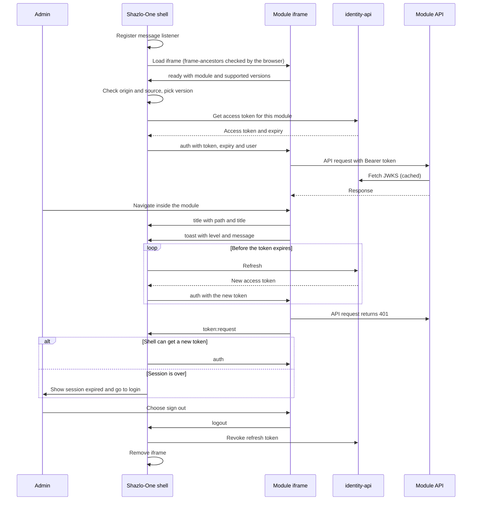
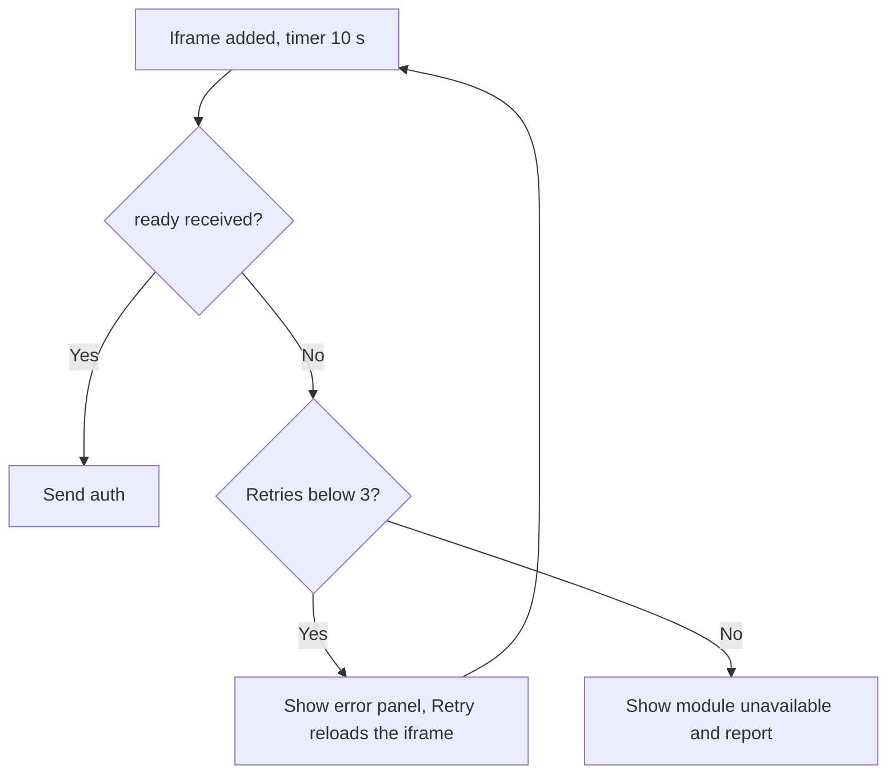

# 0001. Iframe postMessage protocol between Shazlo-One and module UIs

- Status: proposed
- Date: 2026-10-23
- Issue: #30
- Related: [ROADMAP](../ROADMAP.md) Phase 6 (Shazlo-One shell) and Phase 7 (vendor admin module); [0009 auth model](0009-auth-model.md) (#31)

## Context

Shazlo-One is one admin shell. Each microservice ships its own admin UI as a separate web app, and the shell embeds it in an **iframe**. The first module is `vendor-admin` (Phase 7).

The shell and each module run on **different origins** (for example `https://one.shazlo.store` and `https://vendor-admin.shazlo.store`). The shell owns the admin session. A module needs three things from the shell: a short-lived access token for its own backend, the signed-in user's identity and roles, and a way to tell the shell about navigation, notifications and logout.

Constraints:

- No cookie or storage can be shared between the shell and a module. Do not assume a shared parent domain.
- Tokens are short-lived and must never appear in a URL, a log, `localStorage` or `sessionStorage`.
- Neither side may trust the other blindly. A page that frames us, or a page we frame, must not be able to receive or inject messages.
- A module must still work if it is reloaded, opened in a new tab by mistake, or its token expires.

The roadmap fixes the shape (`ready`, `auth`, token refresh, navigation and title sync, `logout`, `toast`). This ADR decides the details.

## Decision

Shell and module talk through `window.postMessage` using a small versioned protocol. The shell is the only source of tokens.

### 1. Envelope

Every message is one object:

| Field | Type | Meaning |
| --- | --- | --- |
| `protocol` | `"shazlo-one"` | Namespace. Receivers drop anything else, so other scripts using postMessage cannot collide |
| `v` | integer | Protocol version (currently `1`) |
| `type` | string | One of the message types below |
| `id` | string (UUID) | Unique per message |
| `replyTo` | string, optional | The `id` this message answers |
| `sentAt` | integer | Milliseconds since epoch, informational only |
| `payload` | object | Type-specific, see the catalogue |

Messages larger than **64 KB** are dropped.

### 2. Message catalogue

**Shell to module**

| Type | Payload | When |
| --- | --- | --- |
| `auth` | `{ accessToken, expiresAt, user: { id, email, roles }, locale? }` | After `ready` (with `replyTo`), and again on every token refresh. `expiresAt` is epoch seconds |
| `navigate` | `{ path }` | The user picked a deep link in the shell. `path` must start with `/` and is relative to the module |
| `error` | `{ code, message }` | The shell cannot continue (for example `version_unsupported`) |

**Module to shell**

| Type | Payload | When |
| --- | --- | --- |
| `ready` | `{ module, supportedVersions, moduleVersion }` | On every page load, before anything else |
| `title` | `{ path, title }` | On each in-module navigation, so the shell can update its breadcrumb, tab title and URL |
| `token:request` | `{ reason: "expired" \| "unauthorized" }` | The module's API call returned 401 or its token is about to expire |
| `logout` | `{ reason? }` | The user chose to sign out inside the module |
| `toast` | `{ level, message, durationMs? }` | The module wants the shell to show a notification. `level` is `info`, `success`, `warning` or `error`. `message` is plain text of at most 280 characters, never HTML |
| `error` | `{ code, message, fatal }` | The module hit a problem the shell should know about. `fatal: true` makes the shell show its error panel |

### 3. Handshake and token handling

1. The shell registers its `message` listener **before** it sets the iframe `src`, so an early `ready` is never missed.
2. The module sends `ready` to the shell origin (`window.parent.postMessage(msg, SHELL_ORIGIN)`).
3. The shell checks the message (section 4), picks the highest version both sides support, and answers with `auth`.
4. The module keeps the token **in memory only** and sends it as `Authorization: Bearer` to its own API. Its API validates the token with the identity service's JWKS, as decided in [ADR 0009](0009-auth-model.md).
5. The shell refreshes the token itself and pushes a new `auth` when about **80% of the lifetime** has passed, or at least 30 seconds before expiry. The module replaces its token and keeps working.
6. If an API call returns 401, the module sends `token:request` at most **once every 30 seconds**. The shell answers with a fresh `auth`, or signs the user out when it cannot get one.
7. The module ignores any `auth` whose `expiresAt` is earlier than the token it already holds.

The token's audience, lifetime and claims come from [ADR 0009](0009-auth-model.md): an access token that lasts 15 minutes, an `aud` that names the module's backend, and `roles` claims. The shell gets each module's token from identity-api's token exchange, not by refreshing the module token itself.

### 4. Origin allow-listing

The shell keeps a **module registry**: for each module its id, URL, exact origin and required roles. Nothing is matched with wildcards or regular expressions.

| Side | Accept a message only if | Send with |
| --- | --- | --- |
| Shell | `event.origin === module.origin` **and** `event.source === iframe.contentWindow` | `postMessage(msg, module.origin)` |
| Module | `event.origin === SHELL_ORIGIN` **and** `event.source === window.parent` | `postMessage(msg, SHELL_ORIGIN)` |

- `*` is never used as a target origin, in any environment.
- `SHELL_ORIGIN` is a build-time setting per environment. The production build fails if it is missing or contains `*`. Local development uses explicit origins such as `http://localhost:5173`, allowed only when the build is a development build.
- After the origin check, both sides drop unknown `type` values, wrong `protocol` or `v`, and payloads that fail validation. They never throw on bad input.

### 5. Headers and iframe attributes

On every module (the framed page):

```
Content-Security-Policy: frame-ancestors https://one.shazlo.store
Referrer-Policy: no-referrer
```

`frame-ancestors` replaces `X-Frame-Options`, so we do not send the older header. Local development adds the local shell origin to `frame-ancestors`.

On the shell, the page CSP lists the registered module origins in `frame-src`, and nothing else.

The iframe element:

```html
<iframe
  src="https://vendor-admin.shazlo.store/"
  title="Vendor admin"
  sandbox="allow-scripts allow-same-origin allow-forms allow-downloads"
  referrerpolicy="no-referrer"
  allow=""
></iframe>
```

| Token | Reason |
| --- | --- |
| `allow-scripts` | The module is a React app |
| `allow-same-origin` | Lets the module use its **own** origin for API calls and storage. This does not weaken the shell, because the module is on a different origin |
| `allow-forms` | Review forms |
| `allow-downloads` | CSV exports from review lists |
| *(omitted)* `allow-top-navigation`, `allow-popups`, `allow-modals` | The module must not navigate the shell, open windows or block with dialogs. It uses `toast` instead |

`allow=""` grants no powerful browser features (camera, microphone, geolocation and so on).

### 6. Versioning

- `v` is an integer. The module lists the versions it supports in `ready`.
- The shell supports the **current and the previous** version. If there is no common version, it sends `error` with `version_unsupported` and shows an error panel with the module's name and version.
- Adding an optional payload field is not a breaking change and does not bump `v`. Removing or renaming a field, or changing its meaning, bumps `v`.

### 7. Failure handling

| Situation | Behaviour |
| --- | --- |
| The module never sends `ready` | After 10 seconds the shell shows an error panel with **Retry**, which reloads the iframe. After 3 failed retries it shows "module unavailable" and reports the failure |
| The module is blocked by a CSP or framing error | The parent cannot see this. It looks the same as "no `ready`" and uses the same timeout |
| The module reloads (or hot-reloads) and sends `ready` again | The shell answers with the current `auth`. The handshake is idempotent |
| The shell cannot refresh the token | It keeps the current token until it expires and retries with backoff (5 s, 15 s, 30 s). At expiry it removes the iframe, shows "session expired" and goes to login |
| The module gets a 401 | `token:request` once per 30 seconds. The shell answers with `auth`, or signs the user out |
| The module's `logout` message | The shell ends the session, revokes the refresh token and removes the iframe |
| The shell navigates away or unmounts | The module notices no `auth` refresh for more than twice the refresh interval and shows "session ended" |
| Unknown type, wrong origin, oversize or malformed message | Dropped silently. A development build logs a warning |
| Clock difference between the shell and the module | `expiresAt` is set by the shell. The module allows 30 seconds of slack |

### 8. Security notes

- postMessage origin checks protect the **channel**. They are not an authentication boundary. Every API call is still validated server-side against the JWKS.
- A cross-site scripting bug in a module can read its in-memory token. The short lifetime and the per-module audience limit the damage.
- The shell never forwards one module's token to another module.

## Message flow



When `ready` does not arrive:



## TypeScript types

These types are the contract. A shared package (`packages/shell-protocol`, proposed in Phase 6) will export them so the shell and every module use the same source. Runtime validation of incoming payloads (for example with `zod`) is required in addition to the types, because `postMessage` data is untyped at runtime.

```ts
export const PROTOCOL = "shazlo-one" as const;
export const PROTOCOL_VERSION = 1 as const;
export const MAX_MESSAGE_BYTES = 64 * 1024;

export interface Envelope<T extends string, P> {
  protocol: typeof PROTOCOL;
  v: number;
  type: T;
  id: string;
  replyTo?: string;
  sentAt: number;
  payload: P;
}

export interface UserInfo {
  id: string;
  email: string;
  roles: string[];
}

/** Shell to module */
export type AuthMessage = Envelope<
  "auth",
  { accessToken: string; expiresAt: number; user: UserInfo; locale?: string }
>;
export type NavigateMessage = Envelope<"navigate", { path: string }>;
export type ShellErrorMessage = Envelope<"error", { code: string; message: string }>;
export type ShellToModule = AuthMessage | NavigateMessage | ShellErrorMessage;

/** Module to shell */
export type ReadyMessage = Envelope<
  "ready",
  { module: string; supportedVersions: number[]; moduleVersion: string }
>;
export type TitleMessage = Envelope<"title", { path: string; title: string }>;
export type TokenRequestMessage = Envelope<
  "token:request",
  { reason: "expired" | "unauthorized" }
>;
export type LogoutMessage = Envelope<"logout", { reason?: string }>;
export type ToastMessage = Envelope<
  "toast",
  { level: "info" | "success" | "warning" | "error"; message: string; durationMs?: number }
>;
export type ModuleErrorMessage = Envelope<
  "error",
  { code: string; message: string; fatal: boolean }
>;
export type ModuleToShell =
  | ReadyMessage
  | TitleMessage
  | TokenRequestMessage
  | LogoutMessage
  | ToastMessage
  | ModuleErrorMessage;

/** The shell's registry entry for a module. Origins are exact, never patterns. */
export interface ModuleRegistration {
  id: string;
  url: string;
  origin: string;
  requiredRoles: string[];
  supportedVersions: number[];
}

/** Shape check only. Payloads must also be validated at runtime. */
export function isEnvelope(data: unknown): data is Envelope<string, unknown> {
  if (typeof data !== "object" || data === null) return false;
  const d = data as Record<string, unknown>;
  return (
    d.protocol === PROTOCOL &&
    typeof d.v === "number" &&
    typeof d.type === "string" &&
    typeof d.id === "string" &&
    typeof d.sentAt === "number" &&
    "payload" in d
  );
}

/** Both sides call this first and drop the message if it returns false. */
export function isTrustedMessage(
  event: MessageEvent,
  trusted: { origin: string; source: MessageEventSource | null },
): boolean {
  return event.origin === trusted.origin && event.source === trusted.source;
}
```

## Consequences

**Easier**
- Modules stay independent: each has its own origin, build and deploy, and needs only this protocol.
- Tokens never touch a URL, cookie or storage, and a module can be developed against a small shell stub.
- One handshake covers first load, reload and refresh.

**Harder**
- Every module must implement the protocol correctly, and a bug (for example accepting `*`) is a security bug. The shared package and contract tests reduce this.
- Debugging across frames is harder. The development build logs dropped messages.
- A framing failure is invisible to the parent, so detection depends on a timeout.

**Follow-ups**
- Create `packages/shell-protocol` with these types, runtime validators and a test harness (Phase 6).
- Decide where the module registry lives (shell config per environment is the proposal).

## Alternatives considered

| Option | Why not |
| --- | --- |
| Token in the iframe URL query string | Leaks through browser history, server logs and the `Referer` header |
| Shared cookies on a parent domain | Couples the origins, adds CSRF risk, and breaks under browsers that block third-party cookies |
| Module Federation instead of iframes | Couples builds, versions and the runtime of every module to the shell; it was explicitly not chosen in the roadmap |
| `window.name` or `localStorage` hand-off | Not origin-scoped or not available across origins; easy to leak |
| `BroadcastChannel` | Same-origin only, so it cannot cross the shell and module origins |
| Each module runs its own login (redirect single sign-on) | Breaks the embedded experience and duplicates session handling; may be reconsidered if a module must run standalone |

## Open items

- Whether `navigate` also needs a reverse "shell asks the module to confirm leaving" message for unsaved changes.
- Telemetry: whether dropped messages are reported in production.
